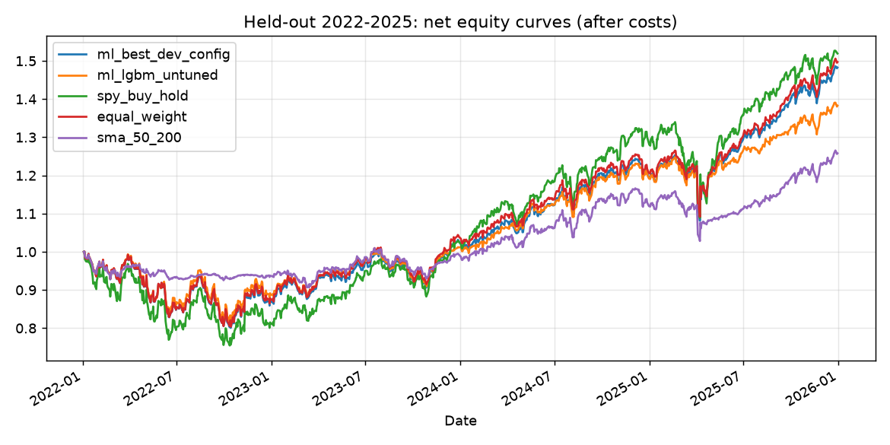

# ML trading research

> Research only, not financial advice. Backtests only. No brokerage connection, no real trades.

This project evaluates whether machine learning models can predict short-term stock returns accurately enough
to cover trading costs. It contains two versions, each tested with walk-forward backtests.

- **v1** (20 tickers, up/down classifier): no signal. An equal-weight basket did as well as the model.
- **v2** (about 520 stocks, GPU models that rank stocks against each other): a small signal. Rank IC is about
  0.03 in every period. The best model, a tuned GRU, earned a long-short Sharpe of 1.00 over 2022 to Nov 2026
  (95% interval 0.26 to 1.76). On the last 118 days it earned 0.65 (interval -1.36 to 2.98). That sample is
  too short to decide anything. A forward test is collecting more.

## Key terms

**The idea.** A model looks at each stock's recent history and predicts how it will do compared with other
stocks over the next 5 trading days. A backtest replays the past to check how a portfolio built from those
predictions would have performed.

**Testing without cheating**

| Term | Meaning |
|---|---|
| Walk-forward | The model is trained on past years only, then tested on the next unseen year. This repeats each year, like real use. |
| Embargo | A 5-day gap between training and test data. Without it, a training label (5-day future return) could overlap the test period. |
| Dev, validation, final, pristine | Dev years (2013-2021) guide all choices. Validation (2019-2021) is a check on the search. Final years (2022-2026) are reported, not tuned on. The pristine tail (from 2026-05-23) was never seen by any decision. |
| Leakage | Any use of future information in a prediction. Tests in `tests/` check that none occurs. |

**Prediction quality**

| Term | Meaning |
|---|---|
| Rank IC (information coefficient) | Each day, the correlation between the model's ranking of stocks and their actual ranking by return. It ranges from -1 to 1. 0 means no skill. Daily values near 0.03 are typical of real signals, and such a signal is small but usable when combined across hundreds of stocks. |
| Interval (95%) | The range that likely contains the true value. If it includes 0, the result could be luck. Computed by bootstrap: resampling 20-day blocks of days 5000 times. |

**Portfolio and performance**

| Term | Meaning |
|---|---|
| Decile | One tenth of the stocks (about 52). The top decile holds the stocks the model likes most. |
| Long-short | Buy the top decile and short the bottom decile. The market's overall move cancels out, so this measures skill alone. |
| Long-only | Buy the top decile and hold no shorts. This also gains from a rising market. |
| Equal-weight universe | Hold every stock in equal amounts. The simple benchmark to beat. |
| Sharpe ratio | Return divided by volatility, annualised. Higher is better. Around 1 is good, and above 2 is rare. |
| Max drawdown (DD) | The largest fall from a peak to a later low. |
| Turnover | How many times a year the portfolio's value is traded. 48x means a full replacement of the book 48 times a year. |
| bps (basis points) | 1 bp is 0.01%. A cost of 7 bps costs 0.07% of each trade. |
| Borrow cost | The yearly fee for shorting a stock (30 bps here). |
| Break-even cost | The trading cost at which the strategy's profit reaches zero. |

**Pitfalls**

| Term | Meaning |
|---|---|
| Survivorship bias | The stock list holds today's S&P 500 members, which tended to rise. Past losers that left the index are missing. |
| Winner's curse | The best of many trials looks better than it is, because its score includes some luck. |
| Forward test | Predictions are logged before outcomes exist, then scored. Nobody can tune them afterwards. |

## v1


- **Data:** 20 ETFs and stocks, daily prices 2011-2025, VIX as context.
- **Label:** forward 5-day return above 0. Features use data up to the close of day *t* only.
- **Splits:** development 2012-2021 (all tuning). Held-out 2022-2025, run once.
- **Models:** logistic regression, LightGBM. **Baselines:** SPY, equal-weight, SMA 50/200.
- **Loop** (`loop.py`): one change per pass, kept if dev net Sharpe rises by more than 0.05.
- **Tests:** features ignore future prices, the embargo holds, weights apply to the next day's return.

Held-out 2022-2025, net of costs:

| Strategy | Sharpe | Ann. return | Max DD |
|---|---|---|---|
| Equal-weight | 0.79 | 10.7% | -19.7% |
| ML (logistic regression) | 0.78 | 10.4% | -20.0% |
| SMA 50/200 | 0.70 | 5.9% | -11.8% |
| ML (LightGBM) | 0.68 | 8.5% | -18.4% |
| SPY buy and hold | 0.67 | 11.1% | -24.5% |



The model matched the equal-weight basket and did not beat it. It is long most names on most days, so it
mostly copies the market.

## v2

Code in `ml2/`. Each day the models rank about 520 stocks and ETFs. The portfolio buys the top decile and
shorts the bottom decile.

- **Data:** 2.6M rows (today's S&P 500 members and 18 ETFs), 2005 to Nov 2026, 109 features: momentum,
  volatility, technicals, 52-week range, volume, overnight gap, beta, sector-relative returns, VIX, calendar.
- **Target:** cross-sectional rank of the 5-day forward return.
- **Models:** ridge, XGBoost (GPU), LightGBM, MLP (GPU), GRU (GPU) and an ensemble that averages their ranks.
- **Validation:** yearly walk-forward with a 5-day embargo. Dev years 2013-2021 drive every decision. Final
  years 2022-2026 are reported, but no tuning used them (one early round saw them once). Days after
  2026-05-22 are the pristine tail, which no decision has seen. Costs: 7 bps per trade, 30 bps per year
  borrow on shorts.
- **Improvement loop** (`ml2/loop.py`): 38 experiments on features, targets, horizons, hyperparameters, model
  families and portfolio rules. A change stays only if it adds 0.0015 mean rank IC and wins 5 of 9 folds.
  One change stayed: raw features instead of rank features. All runs are in `results/v2/experiments.csv`.

Results on 2022 to Nov 2026, net of costs. The headline model is the one with the best dev Sharpe.

| Model | Rank IC | Long-short Sharpe | Long-only Sharpe | Long-only return |
|---|---|---|---|---|
| **GRU, tuned (headline)** | 0.026 | **1.00** | 1.18 | 33.0% |
| Ridge | 0.033 | 0.84 | 1.11 | 31.9% |
| Ensemble | 0.034 | 0.66 | 1.05 | 26.9% |
| MLP, tuned | 0.024 | 0.66 | 1.09 | 30.5% |
| LightGBM | 0.032 | 0.41 | 0.96 | 23.2% |
| XGBoost | 0.030 | 0.33 | 0.93 | 22.7% |
| 12-1 momentum | 0.025 | 0.54 | 1.13 | 31.1% |
| 5-day reversal | 0.012 | -0.25 | 0.72 | 16.1% |
| Equal-weight universe | | | 0.85 | 13.6% |


What the results show:

- The signal is real and small. Every model has a rank IC near 0.03.
- The GRU turns a similar IC into a better portfolio. It trades less (48x a year against 61-69x), so costs
  take less. Its config is heavily regularised: 5 feature groups, a 10-day horizon, a 60-day window, dropout
  0.47, 4 epochs. Ridge comes close at 0.84.
- The long-only top decile beat the equal-weight universe by about 18% a year. Survivorship bias probably
  inflates this gap (see Limitations).
- Dev numbers overstate the GRU because the search tuned on 2013-2018. The final years and the pristine tail
  are the cleaner tests.

### Pristine tail (2026-05-23 to 2026-11-12)

A data bug had hidden every day after 2026-05-22. Two holidays and one unfilled day held only a VIX row, and
one all-missing day breaks every rolling window that contains it. The fix is `drop_incomplete_days`, with a
test. Earlier results did not change.

| Model | Rank IC | Long-short Sharpe | Long-only Sharpe | Long-only return |
|---|---|---|---|---|
| GRU, tuned (headline) | 0.035 | 0.65 | 0.55 | 13.1% |
| Ensemble | 0.027 | 0.54 | 0.98 | 27.4% |
| Ridge | 0.069 | 1.70 | 1.15 | 34.8% |
| MLP, tuned | 0.019 | 0.24 | 0.56 | 14.4% |
| XGBoost | 0.016 | 0.26 | 0.63 | 15.2% |
| LightGBM | 0.023 | 0.35 | 0.71 | 17.7% |
| 12-1 momentum | -0.024 | -0.90 | -0.29 | -18.1% |
| 5-day reversal | 0.044 | 1.55 | 1.47 | 40.2% |
| Equal-weight universe | | | 1.50 | 18.4% |

- Every ML model kept a positive rank IC. The GRU's interval ([-0.010, 0.071]) still includes zero.
- The GRU's long-only book lagged the universe (Sharpe 0.55 against 1.50). Ridge did best and the tuned MLP
  did worst, so the model ranking changes from period to period.
- The tail neither confirms nor rejects the GRU. The signs match earlier periods and the intervals are wide.

### Overnight search (`ml2/search.py`)

An Optuna search on the GPU over seven model families (XGBoost, LightGBM, ranking XGBoost, MLP, GRU, TCN,
transformer), feature groups, targets, horizons, hyperparameters, a rank-IC loss and recency weighting.

- **Protocol:** trials are scored on 2013-2018. The 10 best are scored once on 2019-2021 (validation). A
  finalist is adopted only if it passes `search.gate`: a validation IC gain above 0.003 over the adopted config
  of its family, wins in 2 of 3 years, and a validation long-short Sharpe at least as high.
- **Totals:** about 700 trials. 558 completed, 129 were pruned and 12 failed (5 ran out of GPU memory, 7 were
  interrupted by pauses). The last 61 completed trials never got a finalist check.
- **Round one:** TPE favoured GRUs (84 of the first 147 trials). The top GRUs reached validation IC 0.033 and
  long-short Sharpe 1.22-1.29 (baseline 0.0305 and 0.86). One was adopted.
- **The MLP adoption failed.** An MLP (trial 258) passed the first gate with a validation IC gain of 0.0025.
  Its dev Sharpe rose from 0.62 to 0.96, but on the pristine tail it fell from 1.68 to 0.24. A gain that small
  over three years is within luck. The Sharpe condition and the larger margin were added to the gate afterwards.
  The GRU stays the headline model.
- **Winner's curse:** the trial with the highest tune IC (0.0385, an MLP) validated at only 0.032.
- **Fixes:** one transformer trial would have run for two hours, so every trial now has a 10-minute budget. A
  restart replayed old random draws until the seed depended on the trial count.

### Exploration round (`ml2/explore.py`)

Run before the search, on the all-XGBoost ensemble. Long-short Sharpe after costs. Only dev decided the choice.
The final-years column is a second look, since those years were already seen once.

| Variant | Dev 2013-21 | Final 2022-26 |
|---|---|---|
| Base: top/bottom decile, 5-day book | 0.78 | 0.41 |
| Buffer: enter top 10%, exit below 40% | **1.01** | 0.58 |
| Score smoothing (EMA, half-life 5) | 0.70 | 0.55 |
| Sector-neutral book | 0.75 | 0.34 |
| Blend 25% with momentum rank | 0.60 | 0.87 |
| Blend 50% with momentum rank | 0.33 | 0.94 |

- The 10/40 buffer won on dev (7 of 9 folds) and improved the second look. Choosing 1 of 12 variants adds
  some selection bias.
- Momentum blends hurt on dev and helped on 2022-2026, so they were not adopted.
- Smoothing cut turnover from 66x to 33-49x but also cut rank IC.
- A beta-adjusted target was worse (dev rank IC 0.023 against 0.032).

### How much could be luck? (`ml2/significance.py`)

95% block-bootstrap intervals (20-day blocks, 5000 resamples) for the tuned GRU. `results/v2/significance.csv`
also holds the ensemble.

| Statistic | Dev 2013-21 | Final 2022-26 | Pristine tail |
|---|---|---|---|
| Rank IC | 0.036 [0.023, 0.048] | 0.026 [0.012, 0.041] | 0.035 [-0.010, 0.071] |
| Long-short Sharpe | 1.26 [0.59, 1.94] | 1.00 [0.26, 1.76] | 0.65 [-1.36, 2.98] |
| Long-only Sharpe | 1.50 [0.82, 2.25] | 1.18 [0.45, 2.00] | 0.56 [-1.40, 2.70] |
| Long-short Sharpe minus momentum | 1.37 [0.48, 2.23] | 0.47 [-0.45, 1.36] | 1.38 [0.005, 2.67] |
| Long-only minus equal-weight, yearly return | +16.2% [9.0%, 23.9%] | +18.2% [6.8%, 29.2%] | -0.6% [-69%, +65%] |

- The rank IC interval excludes zero on dev and the final years. On the tail the estimate is similar, but the
  interval is wider than the effect.
- The long-short Sharpe interval excludes zero on the final years but includes it on the 118-day tail.
- The GRU led momentum on every period, but the lead on the final years has an interval that includes zero.
- The long-only edge over the universe held over 2022-2026 and vanished on the tail.
- These intervals treat the model as fixed. They ignore that this GRU was picked from about 150 trials, so the
  true uncertainty is larger.

### Cost sensitivity (`ml2/costs.py`)

Tuned GRU, net Sharpe at different one-way costs. The results above use 7 bps. More variants are in
`results/v2/cost_sensitivity.csv`.

| Book | Period | Turnover/yr | 0 bps | 7 bps | 14 bps | 21 bps | Break-even |
|---|---|---|---|---|---|---|---|
| Long-short | Dev | 43x | 1.67 | 1.26 | 0.84 | 0.42 | 28 bps |
| Long-short | Final | 48x | 1.37 | 1.00 | 0.64 | 0.27 | 26 bps |
| Long-only | Dev | 37x | 1.61 | 1.50 | 1.39 | 1.28 | 104 bps |
| Long-only | Final | 39x | 1.28 | 1.18 | 1.08 | 0.98 | 89 bps |

- The GRU's long-short break-even is 26-28 bps, against 18-21 bps for the ensemble, because it trades less.
  That covers large-cap execution costs, but wide retail spreads would erase it.
- The long-only book survives costs up to about 90 bps.
- The holding buffer makes no consistent difference for the GRU.

### Forward test (`ml2/forward.py`)

The pristine tail has only 118 days. The forward test logs the headline model's ranking of the latest day
before the outcome is known, then scores it once prices arrive. Nobody can tune it after the fact.

```bash
python -m ml2.data && python -m ml2.dataset     # refresh prices and features
python -m ml2.forward predict                   # train on all labelled days, rank the latest day
python -m ml2.forward score                     # rank IC and top-minus-bottom return per finished day
```

- Live predictions go to `results/forward/`. `predict <model> <YYYY-MM-DD>` replays a past day into
  `results/forward/replay/`, and the scorer marks those separately.
- First entry: the GRU's ranking of the 2026-11-12 close (52 longs, 51 shorts). Its 5-day outcome is known
  after 2026-11-19.
- A replay of 2026-09-01 with ridge scored a rank IC of 0.11, and a unit test checks the scorer on a
  hand-computed ranking.
- The 2026-11-12 entry used the first-config GRU. `best_config.json` now holds the round-three GRU, so later
  entries use that one and the model changes within the log. Score the two groups of days separately.
- Run `predict` every trading day and `score` every week. A few hundred days would settle what 118 cannot.

### Round three: targets, turnover, features, wider search

The tables above come from the first config (commit 7d1d730). Round three changed the dataset (133 features,
four new groups) and tested five ideas, tuning only on 2013-2018 and validating on 2019-2021. The final years
were scored once, for one config fixed in commit 3527229. Code: `ml2/phase1.py` to `phase3.py`, `ml2/search.py`.

| Idea | Result |
|---|---|
| Sector-neutral target (rank within sector) | Helped XGBoost and LightGBM on both periods. Adopted. |
| Longer targets (10-day rank, mean rank over 5/10/21 days) | GRU Sharpe 0.96 to about 1.15-1.19 and turnover 57x to 43x on the tune years. Adopted at 10 days. |
| Residual, volatility-scaled and triple-barrier targets | Worse than the rank target. Dropped. |
| Turnover penalty in the loss | Never helped the GRU. The MLP at the largest penalty matched the Sharpe at one-seventh of the turnover, but other penalty values were unstable. Left in the search space only. |
| Four new feature groups, dropping old groups | No change held on both periods. Dropping the market group helped on 2013-2018 and reversed on 2019-2021. Nothing adopted. |
| Search with the new targets and penalty | 228 trials. Three finalists passed the gate (two GRUs, one MLP). One GRU and the MLP were adopted. |

Net long-short Sharpe, old config against new config:

| Model | Dev old | Dev new | Final old | Final new |
|---|---|---|---|---|
| XGBoost | 0.69 | 0.83 | 0.32 | 0.40 |
| MLP | 0.96 | 1.05 | 0.66 | 0.92 |
| GRU | 1.26 | 1.23 | 1.00 | 0.54 |
| Ensemble | 1.04 | 1.30 | 0.66 | 0.69 |

- **The dev gain did not carry over.** The ensemble rose from 1.04 to 1.30 on dev, which includes the years
  the search tuned on, and from 0.66 to 0.69 on 2022-2026. Its rank IC fell from 0.034 to 0.030.
- **The GRU got worse out of sample.** The adopted GRU passed the gate on 2019-2021 (Sharpe 1.58) and scored
  0.54 on the final years. This repeats the MLP failure above: a config picked from many trials loses most of
  its edge. Only the MLP and the tree models improved, and by amounts inside the bootstrap intervals.
- **Pristine tail:** the new ensemble scored rank IC 0.036 and long-short Sharpe 1.33, against 1.50 for the
  universe long-only. 118 days cannot separate it from the old config.
- **Conclusion:** the sector target and longer horizons are the changes most likely to be real, because they
  helped on every split for several models. Differences below about 0.2 Sharpe are noise at this sample size.
  The model choice and the search gains are not established. The forward test is the remaining evidence.
- **Intervals and costs for the new config** (`results/v2/significance.csv`, `cost_sensitivity.csv`; the
  tables above describe the first config):

| Statistic | Model | Dev 2013-21 | Final 2022-26 |
|---|---|---|---|
| Rank IC | GRU | 0.037 [0.025, 0.049] | 0.022 [0.007, 0.037] |
| Rank IC | Ensemble | 0.040 [0.027, 0.053] | 0.030 [0.017, 0.044] |
| Long-short Sharpe | GRU | 1.23 [0.47, 1.98] | 0.54 [-0.22, 1.29] |
| Long-short Sharpe | Ensemble | 1.30 [0.59, 1.98] | 0.69 [0.03, 1.37] |
| Long-short Sharpe minus momentum | Ensemble | 1.41 [0.58, 2.23] | 0.16 [-0.88, 1.14] |
| Long-only minus equal-weight, yearly return | Ensemble | +12.9% [6.3%, 20.7%] | +11.2% [3.1%, 19.6%] |

  The rank IC interval excludes zero on both periods for both models. The GRU's final long-short Sharpe
  interval includes zero, and neither model beats the momentum factor with confidence on the final years.
  The intervals ignore the 228 trials searched.
- **Costs rose.** The adopted GRU trades 59x a year on the final years (48x before), so its long-short
  break-even falls from 26 bps to 15 bps. The ensemble's break-even is 17 bps on the final years. The
  long-only books survive costs up to about 50 bps.
- **Ensemble membership (dev years only):** all 26 subsets of ridge, XGBoost, LightGBM, MLP and GRU were
  compared. Adding ridge lowered dev Sharpe from 1.30 to 1.15 and validation Sharpe from 1.60 to 1.32. The
  best subset (MLP and GRU, 1.38) beats the four-model ensemble by less than the noise, so the ensemble
  stays. This run did not read the final years.
- `ml2.final` now picks the ensemble as the headline model by dev Sharpe.

## Limitations

- **Survivorship bias (largest):** v2 trades today's S&P 500 members, which have tended to rise. v1 used two
  stocks picked with hindsight. Long-only gains over the universe are probably inflated. A fix needs
  point-in-time index membership, which free data lacks.
- **Selection effects:** the GRU is the best of many trials, and the intervals ignore that. Dev numbers
  include the years the search tuned on.
- **Short evidence:** the final years cover one market regime, and the pristine tail has 118 days.
- **Data bugs:** one bug hid five months of prices from every analysis. It is fixed and tested.
- **Simple execution:** daily closes, no market impact or capacity limits, shorts always available at
  30 bps a year, fractional shares, a flat 7 bps per trade.
- **Free baseline rebalancing:** the equal-weight benchmark rebalances daily at no cost, which flatters it.
- **Free data:** Yahoo Finance adjusted prices can change after the fact.

## Run it

```bash
python -m venv .venv
.venv\Scripts\activate          # Windows; use source .venv/bin/activate elsewhere
pip install -r requirements.txt
python -m data.loader           # download and cache prices
python run_baselines.py         # baselines on the dev period
python experiment.py            # first models
python loop.py                  # experiment loop (dev only)
python final_test.py            # one-shot held-out evaluation
streamlit run app/streamlit_app.py
pytest
```

v2 needs an NVIDIA GPU build of PyTorch (see `requirements-v2.txt`):

```bash
pip install -r requirements-v2.txt
python -m ml2.data              # download about 520 tickers (several minutes)
python -m ml2.dataset           # build and cache the feature table
python -m ml2.loop              # improvement loop; resume with: python -m ml2.loop 11, then python -m ml2.loop 21 20
python -m ml2.search run 10     # GPU search for 10 hours (resumable); then: python -m ml2.search finalists 10
python -m ml2.final             # dev, final and pristine metrics, equity chart
python -m ml2.significance      # bootstrap intervals
python -m ml2.costs             # cost sensitivity
python -m ml2.forward predict   # log today's ranking for the forward test
streamlit run app/streamlit_app.py   # v1 page, plus "2 v2 results" in the sidebar
```

## Next steps

- Point-in-time universe membership, to remove the largest bias.
- Run the forward test for a few hundred trading days.
- Select models on validation long-short Sharpe and rank IC together.
- Volatility targeting, regime filters, triple-barrier labels, purged k-fold cross-validation.
- Bootstrap intervals that count the trials searched, not only the sampling noise.
