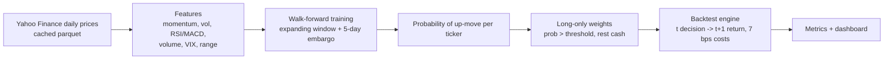
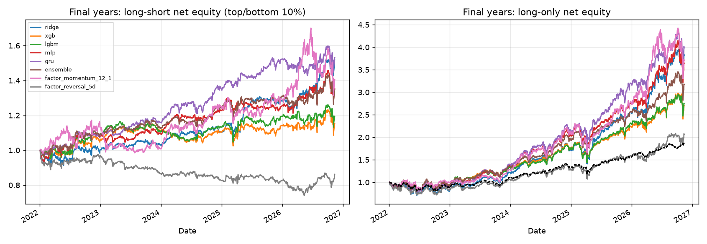

# ML walk-forward backtest (research project)

> **Research only, not financial advice.** Backtests and simulations only. No brokerage connection, no real trades.

A small, leakage-aware machine-learning pipeline that predicts whether each of 20 liquid US ETFs/stocks
will be up over the next 5 trading days, turns the predictions into long-only positions, and evaluates
them with a walk-forward backtest that includes transaction costs. The point of the project is **honest
evaluation**, not a money machine.

## Pipeline



## Method

- **Data:** 20 tickers (broad/sector/bond/gold ETFs + AAPL, MSFT), daily adjusted prices 2011-2025, VIX as context.
- **Label:** forward 5-day return > 0. **Features** use only data up to close *t*.
- **Splits:** development = 2012-2021 (walk-forward test years 2016-2021, all tuning here). **Held-out = 2022-2025**, evaluated once at the end.
- **Costs:** 5 bps cost + 2 bps slippage per unit of one-way turnover.
- **Models:** logistic regression, LightGBM. **Baselines:** SPY buy-and-hold, equal-weight (daily rebalanced), SMA 50/200.
- **Experiment loop** (`loop.py`): greedy, one change per pass, keep only if dev net Sharpe improves by > 0.05; stop after 10 passes or 3 passes without improvement.
- **Tests** (`tests/`): features don't change when future prices change, walk-forward embargo is respected, weights apply to the *next* day's return, costs reduce returns.

## Results

Development (walk-forward 2016-2021, net of costs):

| Strategy | Sharpe | Ann. return | Max DD |
|---|---|---|---|
| Equal-weight | 1.10 | 16.5% | -29.1% |
| SPY buy & hold | 0.99 | 17.5% | -33.7% |
| Logistic regression | 0.96 | 13.8% | -29.1% |
| LightGBM (untuned) | 0.71 | 9.3% | -28.3% |

Held-out 2022-2025 (net of costs, run once):

| Strategy | Sharpe | Ann. return | Max DD | Turnover/yr |
|---|---|---|---|---|
| Equal-weight | 0.79 | 10.7% | -19.7% | 0.25 |
| **ML (logreg, best dev config)** | **0.78** | 10.4% | -20.0% | 3.8 |
| SMA 50/200 | 0.70 | 5.9% | -11.8% | 1.7 |
| SPY buy & hold | 0.67 | 11.1% | -24.5% | 0.25 |
| ML (LightGBM, untuned) | 0.68 | 8.5% | -18.4% | 23.2 |


### Honest conclusion

**The model did not beat a simple equal-weight basket.** On the held-out period it was statistically
indistinguishable from it (Sharpe 0.78 vs 0.79), and on the development period it was lower.
Its equity curve tracks the basket closely because the classifier is mostly "long" most names most days,
so it adds little beyond market exposure. It did beat SPY on Sharpe and drawdown in 2022-2025, but that
is mainly diversification, not predictive skill.

## v2: large-scale cross-sectional ML (GPU)

A bigger rebuild in `ml2/`. Instead of "will this ticker go up", the models rank about 520 stocks and ETFs
against each other each day and a portfolio goes long the top decile and short the bottom decile.

- **Data:** 2.5M rows (today's S&P 500 members plus 18 ETFs), daily, 2005 to May 2026, 109 features
  (momentum, volatility, technicals, 52-week range, volume and illiquidity, overnight gap vs intraday move,
  beta, sector-relative returns, VIX/SPY context, calendar) plus cross-sectional rank versions.
- **Target:** cross-sectional rank of the 5-day forward return, so market-wide drift cancels out.
- **Models:** ridge, XGBoost (GPU), LightGBM, a PyTorch MLP (GPU), a GRU over the last 30 days of
  price action plus the MLP (GPU), and an ensemble that averages their cross-sectional ranks.
- **Validation:** yearly walk-forward with a 5-day embargo. Dev years 2013-2021 drive every decision.
  Final years 2022-2026 are evaluated once. Costs: 7 bps per trade plus 30 bps/yr borrow on shorts.
- **Improvement loop** (`ml2/loop.py`): 35 passes over features, targets, horizons, hyperparameters, model
  families, portfolio rules and a 25-trial Optuna search. A change is kept only if it gains at least 0.0015
  mean rank IC and wins in at least 5 of 9 folds. The loop stopped on its patience rule twice because
  minor ablations ran before the model families, so it was resumed twice (`loop.py 11`, then `loop.py 21 20`)
  until every candidate ran. All 38 experiments are in `results/v2/experiments.csv`.
- **Outcome of the loop:** one change was kept (raw features instead of rank features, IC 0.030 to 0.032).
  Optuna and the bigger models did not beat the defaults.

Held-out results, 2022 to May 2026 (net of costs, run once; the headline model was chosen on dev Sharpe only):

| Model | Rank IC | Long-short Sharpe | Long-short return | Long-only top decile Sharpe | Long-only return |
|---|---|---|---|---|---|
| **Ensemble (headline)** | 0.031 | 0.41 | 3.6% | 0.98 | 23.6% |
| XGBoost | 0.032 | 0.37 | 3.1% | 0.97 | 23.5% |
| LightGBM | 0.033 | 0.43 | 3.6% | 0.98 | 23.6% |
| MLP | 0.024 | 0.47 | 4.2% | 1.03 | 25.5% |
| GRU | 0.027 | 0.46 | 4.2% | 1.04 | 26.7% |
| Ridge | 0.029 | 0.68 | 6.9% | 1.09 | 30.9% |
| 12-1 momentum factor | 0.030 | 0.84 | 10.9% | 1.37 | 36.9% |
| 5-day reversal factor | 0.008 | -0.56 | -5.8% | 0.62 | 13.2% |
| Equal-weight universe | | | | 0.80 | 13.0% |



### Honest conclusion

- **The signal is real and small.** Mean rank IC is about 0.03 on both dev (ensemble 0.037) and held-out
  data (0.031), and all five models are positive. Ridge reaches 0.024-0.029, so the nonlinear models add a
  little over a linear baseline, and the ensemble is the best on dev.
- **It does not convert into a strong market-neutral strategy.** The ensemble's long-short Sharpe fell from
  0.78 on dev to 0.41 on held-out data. Turnover is about 66x per year, so costs consume much of the edge.
- **A simple momentum factor beat every ML model on the held-out years** (Sharpe 0.84), although it lost
  money on dev (-0.11). This points to regime luck in either direction, and 4.4 years cannot settle it.
- **Long-only top decile beat the equal-weight universe** (Sharpe 0.98 vs 0.80, return 23.6% vs 13.0%), but the
  universe holds only today's S&P 500 members, so survivorship bias probably inflates that gap.
- **Bigger models and tuning gave little.** Deeper trees, larger networks, longer GRU windows and the Optuna
  search moved dev rank IC by at most +0.001, which is within noise. The feature set and target mattered more.

### Exploration round (`ml2/explore.py`)

Tested ways to cut turnover and to combine the ensemble with the simple momentum rule, plus a beta-adjusted
target. Choices used the dev years only. The final years were already seen once, so their numbers below are a
second look, not a clean test. Long-short Sharpe after costs (rank IC shown where the score changes):

| Variant | Dev 2013-21 | Final 2022-26 (second look) |
|---|---|---|
| Base: top/bottom decile, 5-day book | 0.78 | 0.41 |
| Buffer: enter top 10%, exit below 40% | **1.01** | 0.58 |
| Score smoothing (EMA, half-life 5) | 0.70 | 0.55 |
| Sector-neutral book | 0.75 | 0.34 |
| Blend 25% with momentum rank | 0.60 | 0.87 |
| Blend 50% with momentum rank | 0.33 | 0.94 |

- **Chosen on dev: the 10/40 buffer.** It won 7 of 9 dev folds, and it also improved the second look
  (0.41 to 0.58). The gain is modest, turnover stays near 70x per year, and picking one of 12 variants
  carries some selection bias on dev.
- **Momentum blends disagree across periods.** They hurt on dev and helped a lot on 2022-2026. Because dev
  decides the choice, the blend was not adopted. The disagreement shows that momentum's value depends on the regime.
- **Smoothing cuts turnover** (66x to 33-49x) but also cuts rank IC, so net Sharpe does not improve on dev.
- **The beta-adjusted target was worse** (dev rank IC 0.023 vs 0.032), and sector-neutral books did not help.

## Limitations

- **Survivorship / selection bias:** AAPL and MSFT were picked with hindsight; ETFs limit but do not remove this.
- **Dev-set reuse:** several experiments were scored on the same 2016-2021 folds, so dev numbers are optimistic.
  The tuning loop was short (3 passes) and none of its changes were kept.
- **Short samples:** 4 years of held-out data (2022-2025 contains one regime); Sharpe differences of 0.1 are noise.
- **Free rebalancing:** the equal-weight baseline rebalances daily and pays no cost for it, which flatters it slightly.
- **Simplified execution:** daily closes, no market impact, no borrow, fractional shares, long-only.
- **Free data:** Yahoo Finance adjusted prices can be revised.

## Run it

```bash
python -m venv .venv
.venv\Scripts\activate          # Windows; use source .venv/bin/activate elsewhere
pip install -r requirements.txt
python -m data.loader           # download + cache prices
python run_baselines.py         # baselines on dev period
python experiment.py            # first models
python loop.py                  # experiment loop (dev only)
python final_test.py            # one-shot held-out evaluation
streamlit run app/streamlit_app.py
pytest
```

v2 (needs an NVIDIA GPU build of PyTorch, see `requirements-v2.txt`):

```bash
pip install -r requirements-v2.txt
python -m ml2.data              # download ~520 tickers (several minutes)
python -m ml2.dataset           # build and cache the feature table
python -m ml2.loop              # improvement loop; resume with: python -m ml2.loop 11 then python -m ml2.loop 21 20
python -m ml2.final             # dev metrics, one final-years run, equity chart
```

## Ideas for next steps

Cross-sectional ranking (long top-k vs short bottom-k), volatility targeting, regime filters,
triple-barrier labels, purged k-fold CV, point-in-time universe membership.
