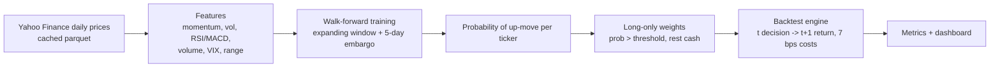

# ML walk-forward backtest (research project)

> **Research only, not financial advice.** Backtests and simulations only. No brokerage connection, no real trades.

A small, leakage-aware machine-learning pipeline that predicts whether each of 20 liquid US ETFs/stocks
will be up over the next 5 trading days, turns the predictions into long-only positions, and evaluates
them with a walk-forward backtest that includes transaction costs. The point of the project is **honest
evaluation**, not a money machine.

## Pipeline



## Method

- **Data:** 20 tickers (broad/sector/bond/gold ETFs + AAPL, MSFT), daily adjusted prices 2011-2025, VIX as context.
- **Label:** forward 5-day return > 0. **Features** use only data up to close *t*.
- **Splits:** development = 2012-2021 (walk-forward test years 2016-2021, all tuning here). **Held-out = 2022-2025**, evaluated once at the end.
- **Costs:** 5 bps cost + 2 bps slippage per unit of one-way turnover.
- **Models:** logistic regression, LightGBM. **Baselines:** SPY buy-and-hold, equal-weight monthly, SMA 50/200.
- **Experiment loop** (`loop.py`): greedy, one change per pass, keep only if dev net Sharpe improves by > 0.05; stop after 10 passes or 3 passes without improvement.
- **Tests** (`tests/`): features don't change when future prices change, walk-forward embargo is respected, weights apply to the *next* day's return, costs reduce returns.

## Results

Development (walk-forward 2016-2021, net of costs):

| Strategy | Sharpe | Ann. return | Max DD |
|---|---|---|---|
| Equal-weight monthly | 1.10 | 16.5% | -29.1% |
| SPY buy & hold | 0.99 | 17.5% | -33.7% |
| Logistic regression | 0.96 | 13.8% | -29.1% |
| LightGBM (untuned) | 0.71 | 9.3% | -28.3% |

Held-out 2022-2025 (net of costs, run once):

| Strategy | Sharpe | Ann. return | Max DD | Turnover/yr |
|---|---|---|---|---|
| Equal-weight monthly | 0.79 | 10.7% | -19.7% | 0.25 |
| **ML (logreg, best dev config)** | **0.78** | 10.4% | -20.0% | 3.8 |
| SMA 50/200 | 0.70 | 5.9% | -11.8% | 1.7 |
| SPY buy & hold | 0.67 | 11.1% | -24.5% | 0.25 |
| ML (LightGBM, untuned) | 0.68 | 8.5% | -18.4% | 23.2 |


### Honest conclusion

**The model did not beat a simple equal-weight basket.** On the held-out period it was statistically
indistinguishable from it (Sharpe 0.78 vs 0.79), and on the development period it was lower.
Its equity curve tracks the basket closely because the classifier is mostly "long" most names most days,
so it adds little beyond market exposure. It did beat SPY on Sharpe and drawdown in 2022-2025, but that
is mainly diversification, not predictive skill.

## Limitations

- **Survivorship / selection bias:** AAPL and MSFT were picked with hindsight; ETFs limit but do not remove this.
- **Dev-set reuse:** several experiments were scored on the same 2016-2021 folds, so dev numbers are optimistic.
  The tuning loop was short (3 passes) and none of its changes were kept.
- **Short samples:** 4 years of held-out data (2022-2025 contains one regime); Sharpe differences of 0.1 are noise.
- **Simplified execution:** daily closes, no market impact, no borrow, fractional shares, long-only.
- **Free data:** Yahoo Finance adjusted prices can be revised.

## Run it

```bash
python -m venv .venv
.venv\Scripts\activate          # Windows; use source .venv/bin/activate elsewhere
pip install -r requirements.txt
python -m data.loader           # download + cache prices
python run_baselines.py         # baselines on dev period
python experiment.py            # first models
python loop.py                  # experiment loop (dev only)
python final_test.py            # one-shot held-out evaluation
streamlit run app/streamlit_app.py
pytest
```

## Ideas for next steps

Cross-sectional ranking (long top-k vs short bottom-k), volatility targeting, regime filters,
triple-barrier labels, purged k-fold CV, point-in-time universe membership.
