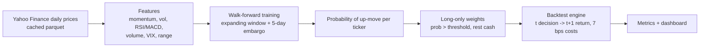

# ML trading research: leakage-aware walk-forward backtests

> **Research only, not financial advice.** Backtests and simulations only. No brokerage connection, no real trades.

One question, asked twice: can machine learning predict short-term stock returns well enough to survive
trading costs? The point of the project is **honest evaluation**, so every result comes with its caveats.

- **v1 (20 tickers, up/down classifier):** no usable signal. A plain equal-weight basket matched the model.
- **v2 (about 520 stocks, GPU models that rank stocks against each other):** a small real signal, with
  rank IC around 0.03 on every period. The headline search-tuned GRU earned a long-short Sharpe of 1.00 over
  2022 to Nov 2026 (95% interval 0.26 to 1.76). On the 118-day pristine tail it earned 0.65 (interval -1.36 to
  2.98), and its long-only book lagged the equal-weight universe. The evidence is encouraging but inconclusive,
  and a forward test is collecting the data that would settle it.

Sections: [v1](#v1-pipeline), [v2 results](#v2-large-scale-cross-sectional-ml-gpu),
[forward test](#forward-test-ml2forwardpy), [limitations](#limitations), [how to run](#run-it).

## v1 pipeline



## v1 method

A small pipeline that predicts whether each of 20 liquid US ETFs and stocks will be up over the next
5 trading days, turns the predictions into long-only positions, and backtests them with transaction costs.

- **Data:** 20 tickers (broad/sector/bond/gold ETFs + AAPL, MSFT), daily adjusted prices 2011-2025, VIX as context.
- **Label:** forward 5-day return > 0. **Features** use only data up to close *t*.
- **Splits:** development = 2012-2021 (walk-forward test years 2016-2021, all tuning here). **Held-out = 2022-2025**, evaluated once at the end.
- **Costs:** 5 bps cost + 2 bps slippage per unit of one-way turnover.
- **Models:** logistic regression, LightGBM. **Baselines:** SPY buy-and-hold, equal-weight (daily rebalanced), SMA 50/200.
- **Experiment loop** (`loop.py`): greedy, one change per pass, keep only if dev net Sharpe improves by > 0.05; stop after 10 passes or 3 passes without improvement.
- **Tests** (`tests/`): features don't change when future prices change, walk-forward embargo is respected, weights apply to the *next* day's return, costs reduce returns.

## v1 results

Development (walk-forward 2016-2021, net of costs):

| Strategy | Sharpe | Ann. return | Max DD |
|---|---|---|---|
| Equal-weight | 1.10 | 16.5% | -29.1% |
| SPY buy & hold | 0.99 | 17.5% | -33.7% |
| Logistic regression | 0.96 | 13.8% | -29.1% |
| LightGBM (untuned) | 0.71 | 9.3% | -28.3% |

Held-out 2022-2025 (net of costs, run once):

| Strategy | Sharpe | Ann. return | Max DD | Turnover/yr |
|---|---|---|---|---|
| Equal-weight | 0.79 | 10.7% | -19.7% | 0.25 |
| **ML (logreg, best dev config)** | **0.78** | 10.4% | -20.0% | 3.8 |
| SMA 50/200 | 0.70 | 5.9% | -11.8% | 1.7 |
| SPY buy & hold | 0.67 | 11.1% | -24.5% | 0.25 |
| ML (LightGBM, untuned) | 0.68 | 8.5% | -18.4% | 23.2 |


### Honest conclusion

**The model did not beat a simple equal-weight basket.** On the held-out period it was statistically
indistinguishable from it (Sharpe 0.78 vs 0.79), and on the development period it was lower.
Its equity curve tracks the basket closely because the classifier is mostly "long" most names most days,
so it adds little beyond market exposure. It did beat SPY on Sharpe and drawdown in 2022-2025, but that
is mainly diversification, not predictive skill.

## v2: large-scale cross-sectional ML (GPU)

A bigger rebuild in `ml2/`. Instead of "will this ticker go up", the models rank about 520 stocks and ETFs
against each other each day and a portfolio goes long the top decile and short the bottom decile.

- **Data:** 2.6M rows (today's S&P 500 members plus 18 ETFs), daily, 2005 to Nov 2026, 109 features
  (momentum, volatility, technicals, 52-week range, volume and illiquidity, overnight gap vs intraday move,
  beta, sector-relative returns, VIX/SPY context, calendar) plus cross-sectional rank versions.
- **Target:** cross-sectional rank of the 5-day forward return, so market-wide drift cancels out.
- **Models:** ridge, XGBoost (GPU), LightGBM, a PyTorch MLP (GPU), a GRU over recent days of price
  action plus the MLP (GPU), and an ensemble that averages their cross-sectional ranks. The GRU and the MLP
  use configs found by the overnight search below; every other model uses the improvement loop's settings.
- **Validation:** yearly walk-forward with a 5-day embargo. Dev years 2013-2021 drive every decision.
  Final years 2022-2026 are reported but no tuning decision uses them (an early round did see them once,
  so they are not a pristine test). The days after 2026-05-22 are pristine: a data bug had hidden them from
  every analysis until it was fixed late (see "Pristine tail"). Costs: 7 bps per trade plus 30 bps/yr borrow on shorts.
- **Improvement loop** (`ml2/loop.py`): 35 passes over features, targets, horizons, hyperparameters, model
  families, portfolio rules and a 25-trial Optuna search. A change is kept only if it gains at least 0.0015
  mean rank IC and wins in at least 5 of 9 folds. The loop stopped on its patience rule twice because
  minor ablations ran before the model families, so it was resumed twice (`loop.py 11`, then `loop.py 21 20`)
  until every candidate ran. All 38 experiments are in `results/v2/experiments.csv`.
- **Outcome of the loop:** one change was kept (raw features instead of rank features, IC 0.030 to 0.032).
  Optuna and the bigger models did not beat the defaults.

Held-out results, 2022 to Nov 2026 (net of costs, base decile book; the headline model is the one with the
best dev Sharpe, and no choice used these years):

| Model | Rank IC | Long-short Sharpe | Long-short return | Long-only top decile Sharpe | Long-only return |
|---|---|---|---|---|---|
| **GRU, search-tuned (headline)** | 0.026 | **1.00** | 9.2% | 1.18 | 33.0% |
| Ensemble | 0.034 | 0.66 | 6.3% | 1.05 | 26.9% |
| XGBoost | 0.030 | 0.33 | 3.0% | 0.93 | 22.7% |
| LightGBM | 0.032 | 0.41 | 3.7% | 0.96 | 23.2% |
| MLP, search-tuned | 0.024 | 0.66 | 6.4% | 1.09 | 30.5% |
| Ridge | 0.033 | 0.84 | 9.0% | 1.11 | 31.9% |
| 12-1 momentum factor | 0.025 | 0.54 | 7.3% | 1.13 | 31.1% |
| 5-day reversal factor | 0.012 | -0.25 | -3.0% | 0.72 | 16.1% |
| Equal-weight universe | | | | 0.85 | 13.6% |


### Honest conclusion

- **The signal is real and small.** Mean rank IC is about 0.03 on both dev and held-out data for every model.
- **Tuning the sequence model mattered most, though a linear model comes close.** The search-tuned GRU turns a
  similar rank IC (0.026) into a better portfolio: long-short Sharpe 1.00 against 0.33-0.66 for the tree models,
  MLP and ensemble. Ridge reaches 0.84. The GRU trades less (48x per year against 61-69x), so costs take a
  smaller share. Its config is heavily regularised: 5 feature groups, a 10-day horizon, an excess-return
  target, a 60-day window, dropout 0.47 and only 4 epochs.
- **The evidence is stronger than in earlier rounds but still bounded.** The config was picked on 2013-2018 and
  confirmed on 2019-2021 (validation rank IC 0.033 against 0.0305 for the XGBoost baseline, winning 2 of 3
  years and losing 2021). The 2022-2026 years played no part in that choice, and its long-short Sharpe
  interval there excludes zero ([0.26, 1.76]).
- **Momentum is an unstable benchmark.** The GRU beat the 12-1 momentum factor on dev (clearly) and on the final
  years (1.00 vs 0.54), though the final-years difference has an interval that includes zero. Momentum did badly
  in the pristine tail (Sharpe -0.90), after doing well in 2022-2025.
- **Long-only top decile beat the equal-weight universe** over 2022-2026 by about 18% a year (return 33.0% vs
  13.6%), but that edge did not appear in the pristine tail (next section). The universe holds only today's
  S&P 500 members, so survivorship bias probably inflates the gap.
- **Caveats on selection.** The GRU config is the best of about 150 first-round search trials, so its numbers carry some
  winner's curse that the intervals below ignore. Its dev numbers include the tune years, so dev overstates it.
  The most reliable figures are validation, the final years and the pristine tail.

### Pristine tail (2026-05-23 to 2026-11-12)

A data bug had silently dropped every day after 2026-05-22 from the dataset, because two holidays and one
unfilled day carried only a VIX row and an all-missing day breaks every rolling window containing it. After the
fix (`drop_incomplete_days`, with a test) the models were scored on the 5.5 months no earlier decision saw.
Results are unchanged for earlier dates. About 118 trading days is a short sample.

| Model | Rank IC | Long-short Sharpe | Long-only top decile Sharpe | Long-only return |
|---|---|---|---|---|
| GRU, search-tuned (headline) | 0.035 | 0.65 | 0.55 | 13.1% |
| Ensemble | 0.027 | 0.54 | 0.98 | 27.4% |
| Ridge | 0.069 | 1.70 | 1.15 | 34.8% |
| MLP, search-tuned | 0.019 | 0.24 | 0.56 | 14.4% |
| XGBoost | 0.016 | 0.26 | 0.63 | 15.2% |
| LightGBM | 0.023 | 0.35 | 0.71 | 17.7% |
| 12-1 momentum factor | -0.024 | -0.90 | -0.29 | -18.1% |
| 5-day reversal factor | 0.044 | 1.55 | 1.47 | 40.2% |
| Equal-weight universe | | | 1.50 | 18.4% |

- **The ranking signal persisted.** Every ML model has a positive rank IC, including the GRU at 0.035, but the
  GRU's interval includes zero ([-0.010, 0.071]) on a sample this short.
- **The GRU's long-only book lagged the universe** (Sharpe 0.55 vs 1.50, return 13.1% vs 18.4%). Its
  long-short Sharpe was positive (0.65), so the top decile beat the bottom decile without beating the average
  stock. Ridge did best here and the search-tuned MLP did worst, so the ranking of models is not stable across periods.
  The tuned MLP's weak tail (it was the MLP that the search had just adopted) is a warning about adopting small
  validation gains.
- **Verdict:** the tail neither confirms nor refutes the GRU. The sign of its rank IC and long-short return
  matches earlier periods, and every interval is wide.

### Overnight search (`ml2/search.py`)

An unattended Optuna search on the GPU: seven model families (XGBoost, LightGBM, ranking-objective XGBoost,
MLP, GRU, TCN, transformer), feature groups, raw vs rank features, targets, horizons, hyperparameters, a
rank-IC training loss and recency weighting. Protocol: trials are scored only on 2013-2018 (tune years). The
10 best are scored once on 2019-2021 (validation). The first adoption needed a validation rank IC gain above
0.002 over the baseline and wins in 2 of 3 years. After the MLP case below, the gate (`search.gate`, tested)
requires a gain above 0.003 over the adopted config of the same family, wins in 2 of 3 years, and a validation
long-short Sharpe at least as high. Among passing finalists the one with the best tune score is taken, so
validation acts as a gate and never as a second tuning set.

- **Round one, 150 trials:** 127 completed, 18 pruned, 5 failed on GPU memory. TPE concentrated on GRUs (84 of
  the first 147 trials), whose mean tune IC (0.030) beat the other families (0.021-0.025).
- **Round one finalists:** the top GRUs reached validation IC 0.033 and long-short Sharpe 1.22-1.29 (baseline
  0.0305 and 0.86). They are near-copies of one config, so this is one finding and not ten. One was adopted.
- **Round two, first check (227 trials):** finalists had to beat the adopted GRU. None did. The best, an MLP
  (trial 222), reached validation IC 0.0338 against 0.0334, a gain of 0.0004 where 0.002 was required. The
  trial with the highest tune IC of all (0.0385, an MLP) validated at only 0.032, which is the winner's curse
  that the validation gate is there to catch.
- **Round two, second check (349 trials):** an MLP (trial 258) reached validation IC 0.0359, a gain of 0.0025,
  and won 2 of 3 validation years, so it passed the gate and became the MLP member's config. It did not
  generalise well. Its dev long-short Sharpe rose from 0.62 to 0.96, but on the final years it moved only from
  0.59 to 0.66, and on the pristine tail it fell from 1.68 to 0.24. Its validation long-short Sharpe (1.00) was
  already below the GRU's (1.22). This was the fourth finalist check, so a gain of 0.0025 on three years was
  within what luck can produce. The GRU stays the headline model, and the gate would need a larger margin or
  a Sharpe condition to be trusted on small gains.
- **Later checks and totals:** two more finalist checks (after 458 and 609 trials) found nothing that passed the
  stricter gate. In all, the search ran about 700 trials: 558 completed, 129 pruned and 12 failed (5 on GPU
  memory, 7 interrupted when the search was paused for finalist runs). The best completed tune IC stayed at
  0.0385, from an MLP that validated at only 0.032. A final check on the last 61 completed trials was skipped
  for lack of time, so those trials are unscored on the validation years.
- **Engineering lessons:** a first run stalled on one transformer trial that would have taken two hours, so every
  trial now has a 10-minute budget. A restart also replayed old random draws until the seed was changed.

### Exploration round (`ml2/explore.py`)

Run before the overnight search, on the earlier all-XGBoost-settings ensemble (not rerun for the tuned GRU,
whose own cost analysis is below). Tested ways to cut turnover and to combine the ensemble with the simple
momentum rule, plus a beta-adjusted target. Choices used the dev years only. The final years were already seen once, so their numbers below are a
second look, not a clean test. Long-short Sharpe after costs (rank IC shown where the score changes):

| Variant | Dev 2013-21 | Final 2022-26 (second look) |
|---|---|---|
| Base: top/bottom decile, 5-day book | 0.78 | 0.41 |
| Buffer: enter top 10%, exit below 40% | **1.01** | 0.58 |
| Score smoothing (EMA, half-life 5) | 0.70 | 0.55 |
| Sector-neutral book | 0.75 | 0.34 |
| Blend 25% with momentum rank | 0.60 | 0.87 |
| Blend 50% with momentum rank | 0.33 | 0.94 |

- **Chosen on dev: the 10/40 buffer.** It won 7 of 9 dev folds, and it also improved the second look
  (0.41 to 0.58). The gain is modest, turnover stays near 70x per year, and picking one of 12 variants
  carries some selection bias on dev.
- **Momentum blends disagree across periods.** They hurt on dev and helped a lot on 2022-2026. Because dev
  decides the choice, the blend was not adopted. The disagreement shows that momentum's value depends on the regime.
- **Smoothing cuts turnover** (66x to 33-49x) but also cuts rank IC, so net Sharpe does not improve on dev.
- **The beta-adjusted target was worse** (dev rank IC 0.023 vs 0.032), and sector-neutral books did not help.

### How much could be luck? (`ml2/significance.py`)

95% block-bootstrap intervals (20-day blocks, 5000 resamples) for the search-tuned GRU with the base decile book.
Per-model results are in `results/v2/significance.csv`, which also holds the ensemble.

| Statistic | Dev 2013-21 | Final 2022-26 | Pristine tail (118 days) |
|---|---|---|---|
| Rank IC (mean per day) | 0.036 [0.023, 0.048] | 0.026 [0.012, 0.041] | 0.035 [-0.010, 0.071] |
| Long-short Sharpe | 1.26 [0.59, 1.94] | 1.00 [0.26, 1.76] | 0.65 [-1.36, 2.98] |
| Long-only top decile Sharpe | 1.50 [0.82, 2.25] | 1.18 [0.45, 2.00] | 0.56 [-1.40, 2.70] |
| Long-short Sharpe minus momentum factor | 1.37 [0.48, 2.23] | 0.47 [-0.45, 1.36] | 1.38 [0.005, 2.67] |
| Long-only minus equal-weight, annual return | +16.2% [9.0%, 23.9%] | +18.2% [6.8%, 29.2%] | -0.6% [-69%, +65%] |

- **The ranking signal is statistically real over the long periods.** The rank IC interval excludes zero on
  dev and on the final years. On the pristine tail the estimate is similar (0.035) but the interval is wider
  than the effect.
- **The GRU's long-short Sharpe interval excludes zero on the final years** ([0.26, 1.76]) but not on the
  118-day tail, which is too short to settle anything.
- **The momentum comparison is open.** The GRU led by 0.47 on the final years (interval includes zero) and by
  1.38 on the tail, where momentum lost money. On dev it led by 1.37 with an interval that excludes zero.
- **The long-only edge over the equal-weight universe held over 2022-2026 and vanished on the tail**
  (-0.6%, interval spanning -69% to +65%). It also carries the survivorship bias described below, which these
  intervals do not measure.
- **The intervals treat the model and portfolio as fixed.** They ignore the choice of this GRU among about 150
  first-round trials, so the true uncertainty is larger. The dev interval also includes years the search tuned on.

### Cost sensitivity (`ml2/costs.py`)

Search-tuned GRU, base decile book, net Sharpe at different one-way trading costs (the results above use 7 bps).
The ensemble and the holding-buffer variants are in `results/v2/cost_sensitivity.csv`.

| Book | Period | Turnover/yr | 0 bps | 7 bps | 14 bps | 21 bps | Break-even cost |
|---|---|---|---|---|---|---|---|
| Long-short | Dev 2013-21 | 43x | 1.67 | 1.26 | 0.84 | 0.42 | 28 bps |
| Long-short | Final 2022-26 | 48x | 1.37 | 1.00 | 0.64 | 0.27 | 26 bps |
| Long-only top decile | Dev 2013-21 | 37x | 1.61 | 1.50 | 1.39 | 1.28 | 104 bps |
| Long-only top decile | Final 2022-26 | 39x | 1.28 | 1.18 | 1.08 | 0.98 | 89 bps |

- **The GRU is far less cost-sensitive than the earlier ensemble.** Its long-short break-even cost is 26-28 bps,
  against 18-21 bps for the ensemble, because it trades 43-48x per year instead of 61-63x. That covers
  typical large-cap execution costs, though not wide retail spreads.
- **The long-only book holds up to about 90 bps**, because it keeps the market's upside and only tilts
  toward the top decile.
- **The holding buffer makes no consistent difference for the GRU** (long-short Sharpe 1.25 vs 1.26 on dev,
  1.04 vs 1.00 on the final years). It helped the earlier ensemble, whose daily book changed more.

### Forward test (`ml2/forward.py`)

Every result above is a backtest, and the pristine tail covers only 118 days. The forward test builds a record
that cannot be tuned after the fact: it logs the headline model's ranking of the latest day before the outcome is
known, and scores it once prices arrive.

```bash
python -m ml2.data && python -m ml2.dataset     # refresh prices and features
python -m ml2.forward predict                   # train on everything labelled so far, rank the latest day
python -m ml2.forward score                     # rank IC and top-minus-bottom return for each finished day
```

- **Live predictions** go to `results/forward/`. `predict <model> <YYYY-MM-DD>` replays a past day into
  `results/forward/replay/` to test the code, and the scorer marks those separately.
- **First entry:** the GRU's ranking of the 2026-11-12 close (52 longs, 51 shorts), logged on 2026-11-14. Its
  5-day outcome is known after 2026-11-19.
- **Checks:** a replay of 2026-09-01 with ridge scored a rank IC of 0.11, and a unit test checks the scoring on
  a hand-computed ranking.
- **How to use it:** run `predict` each trading day and `score` weekly. A few hundred days of forward data
  would settle questions that the 118-day tail cannot.

## Limitations

- **Survivorship bias (largest):** v2 trades today's S&P 500 members, which are survivors that tend to have
  risen, and v1 used two hindsight-picked stocks. Long-only gains against the universe are probably inflated.
  A fix needs point-in-time index membership, which free data does not provide.
- **Selection effects:** the GRU is the best of many search trials, and the intervals ignore that choice. The
  tuned MLP showed what a luck-driven adoption looks like. Dev numbers include the years the search tuned on.
- **Short out-of-sample evidence:** the final years hold one market regime, and the pristine tail has 118
  days, so its intervals are wide. The forward test is the way to add clean data over time.
- **Data handling:** a bug once hid five months of prices from every analysis, because an all-missing holiday
  row breaks rolling windows. It is fixed and tested, and it shows how silent such failures can be.
- **Simplified execution:** daily closes, no market impact or capacity limits, shorts always available at
  30 bps per year, fractional shares, and a flat 7 bps per trade.
- **Free rebalancing in baselines:** the equal-weight benchmark rebalances daily at no cost, which flatters it.
- **Free data:** Yahoo Finance adjusted prices can be revised.

## Run it

```bash
python -m venv .venv
.venv\Scripts\activate          # Windows; use source .venv/bin/activate elsewhere
pip install -r requirements.txt
python -m data.loader           # download + cache prices
python run_baselines.py         # baselines on dev period
python experiment.py            # first models
python loop.py                  # experiment loop (dev only)
python final_test.py            # one-shot held-out evaluation
streamlit run app/streamlit_app.py
pytest
```

v2 (needs an NVIDIA GPU build of PyTorch, see `requirements-v2.txt`):

```bash
pip install -r requirements-v2.txt
python -m ml2.data              # download ~520 tickers (several minutes)
python -m ml2.dataset           # build and cache the feature table
python -m ml2.loop              # improvement loop; resume with: python -m ml2.loop 11 then python -m ml2.loop 21 20
python -m ml2.search run 10     # unattended GPU search for 10 hours (resumable); then: python -m ml2.search finalists 10
python -m ml2.final             # dev, final and pristine-tail metrics, equity chart
python -m ml2.significance      # bootstrap confidence intervals
python -m ml2.costs             # cost sensitivity
python -m ml2.forward predict   # log today's ranking for the forward test (see below)
streamlit run app/streamlit_app.py   # v1 page, plus "2 v2 results" in the sidebar
```

## Ideas for next steps

- Point-in-time universe membership, to remove the largest bias.
- Let the forward test run for a few hundred trading days and score it weekly.
- Select models on validation long-short Sharpe and rank IC together instead of IC alone.
- Volatility targeting, regime filters, triple-barrier labels and purged k-fold cross-validation.
- A turnover-aware training loss, since turnover decided which model survived costs.
